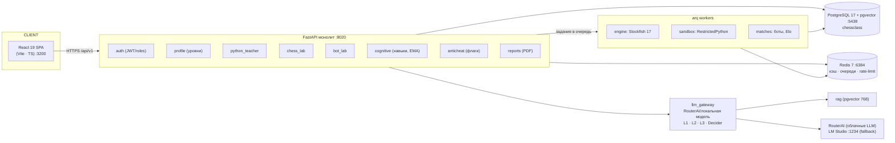

# Design.md — Единая экосистема «Шахматно-программистский класс» (ChessClass)

**Версия:** v0.1.0 Draft · **Дата:** 2026-10-31
**Стек:** Python 3.12 + FastAPI · React 19 + Vite + TypeScript · PostgreSQL 17 + pgvector · Redis 7 · Stockfish 17 · RestrictedPython 8.5 · python-chess · LM Studio / RouterAI (OpenAI-совместимые LLM) · arq · Docker Compose
**© 2026 RuChating (iilmchat)**

---

> **Правила чтения документа.** Это исходный дизайн-документ проекта — источник
> истины по архитектуре и решениям. Контракты (схема БД, эндпоинты, JSON-форматы,
> критерии приёмки) будут зафиксированы в `docs/SPEC.md`; правила процесса
> (ветки, ревью, отчёты спринтов) — в `docs/RULES.md`; разбивка текущего этапа
> на спринты — в `TODO_V0.1.md`. Хаб документации — `docs/README.md`.
> Действует принцип **«один факт — один источник»**: если факт описан здесь,
> в других документах дают ссылку, а не копию.

## Оглавление

1. [Концепция](#1-концепция)
2. [Область работ](#2-область-работ)
3. [Архитектура](#3-архитектура)
4. [Профиль ученика, уровни, роли](#4-профиль-ученика-уровни-роли)
5. [Модуль Python (python_teacher)](#5-модуль-python-python_teacher)
6. [Модуль Шахматы (chess_lab)](#6-модуль-шахматы-chess_lab)
7. [Лаборатория ботов (новое ядро)](#7-лаборатория-ботов-новое-ядро)
8. [Единый LLM-шлюз (RouterAI)](#8-единый-llm-шлюз-routerai)
9. [Кросс-валидация и защита от списывания](#9-кросс-валидация-и-защита-от-списывания)
10. [Когнитивный дашборд](#10-когнитивный-дашборд)
11. [Данные (PostgreSQL)](#11-данные-postgresql)
12. [API (v1)](#12-api-v1)
13. [Безопасность и приватность](#13-безопасность-и-приватность)
14. [Фронтенд](#14-фронтенд)
15. [Инфраструктура и эксплуатация](#15-инфраструктура-и-эксплуатация)
16. [Качество, тесты, документация](#16-качество-тесты-документация)
17. [Дорожная карта (этапы → спринты)](#17-дорожная-карта-этапы--спринты)
18. [Риски и открытые вопросы](#18-риски-и-открытые-вопросы)
19. [Журнал решений (ADR)](#19-журнал-решений-adr)
20. [Инвентарь переноса из двух проектов](#20-инвентарь-переноса-из-двух-проектов)

---

## 1. Концепция

### 1.1. Один класс — два языка мышления

**ChessClass** — образовательная платформа для «шахматно-программистского
класса»: дети занимаются **Python** и **шахматами** в одной системе. Экосистема
не является суммой двух приложений — она строится вокруг общего ядра:

- **единый профиль ученика** с одним уровнем, общим для обоих доменов;
- **единый 3-уровневый AI-ассистент** с маршрутизацией LLM по сложности и цене;
- **единый учёт навыков** (когнитивный дашборд) с кросс-доменными связями;
- **кросс-валидация честности**: анти-списывание в коде и в шахматах, взаимная
  сверка профиля («пишет код уровня novice, но обыгрывает Stockfish 1800»).

### 1.2. Продуктовое ядро v0.1 (диагональ ценности)

1. Ученик решает **Python-задания**: автотесты в изолированной песочнице
   (RestrictedPython) + ступенчатые LLM-подсказки и комментарии.
2. Ученик разбирает **позиции и партии**: факты даёт верифицируемый
   Stockfish 17, объяснения — LLM (уровень ученика определяет модель и тон).
3. Ученик пишет **собственного шахматного бота на Python** (функция
   `choose_move(position)`) и гоняет его против лестницы оппонентов
   (random → greedy → minimax → Stockfish по Elo); система ведёт рейтинг бота.
   Это новый, сквозной модуль — «демо-стенд» всей экосистемы.
4. Платформа копит **события навыков** и показывает прогресс ученику,
   учителю и родителю (PDF-отчёт).
5. Учитель видит **флаги анти-списывания** и профиль каждого ученика.

### 1.3. Перенос навыков (принцип сквозных связей)

Связки «код ⇄ шахматы» зашиты в реестр навыков (`skill_links`, §10):
вложенные циклы → вилки; условия/осторожность → висячие фигуры;
функции/декомпозиция → план на партию; отладка → разбор блюндеров;
сложность/оптимизация → глубина перебора.

### 1.4. Принципы проектирования

- **Слабая связность**: домены (python_teacher, chess_lab, bot_lab) не
  импортируют друг друга напрямую — общение через ядро (профиль, события,
  флаги, LLM-шлюз).
- **Vendoring, не reinvention**: проверенные модули `ai-teacher_python`
  (песочница, уровни, LLM-policy) и `ai-chess-annotator` (движок, промпты,
  отчёты) копируются в монорепозиторий с адаптацией импортов; имена
  копируемых файлов — в §20.
- **Верифицируемость**: всё, что утверждает система о шахматах, исходит от
  Stockfish; LLM отвечает только «текстом», не «фактами». Всё, что
  утверждается о коде, исходит от исполнения тестов в песочнице.
- **Русский язык** интерфейса и документации; LLM-промпты — на русском
  (адаптированные из обоих проектов).
- **Экономика LLM видна**: каждый вызов логируется с ценой в ₽; никто, кроме
  шлюза, LLM не вызывает.

### 1.5. Не-цели (не делаем в этой версии)

- Переписывание двух существующих продуктов «с нуля».
- Приложения для телефона, соцфункции, турниры между ботами учеников — backlog.
- Автобаны и автоматические оценки «честности» — только флаги для учителя.

---

## 2. Область работ

### 2.1. v0.1.0 — MVP экосистемы (включено)

| ID | Функция | Кратко | Домен |
|----|---------|--------|-------|
| F-01 | Аутентификация и роли | PyJWT + Argon2id, refresh в HttpOnly-cookie, email-верификация; роли student/teacher/admin | core.auth |
| F-02 | Профиль и уровни | Единый уровень `novice/intermediate/advanced`, override на запрос; статус email | core.profile |
| F-03 | Python-домен | Задания, сдача решений, песочница, тесты, подсказки, комментарии | python_teacher |
| F-04 | Шахматный домен | Позиции, инсайт, анализ PGN, блюндер-фидбек, комментарии | chess_lab |
| F-05 | Лаборатория ботов | Контракт `choose_move`/`evaluate`, лестница оппонентов, Elo, матчи на arq | bot_lab |
| F-06 | LLM-шлюз RouterAI | Реестр маршрутов `<domain>.<op>`×level, L1/L2/L3 + Decider-judge, fallback, цены ₽/1M, бюджеты | llm |
| F-07 | RAG | pgvector, единая размерность 768, база знаний для ассистента | rag |
| F-08 | Когнитивный дашборд | Реестр ~10 навыков, `cognitive_skill_events`, недельные EMA, UI дашборда | cognitive |
| F-09 | Анти-списывание | 5 типов флагов, LLM-judge (Decider), дашборд учителя | anticheat |
| F-10 | Кросс-доменные связи | `skill_links` seed, профиль-сверка (`profile_mismatch`) | cognitive |
| F-11 | PDF-отчёт родителям | fpdf2 + TTF, качество из annotator | reports |
| F-12 | Инфраструктура | docker-compose dev/prod/observability, порты, логи, миграции | infra |

### 2.2. v0.2 и Backlog (не в MVP)

- **v0.2:** озвучка ответов (ElevenLabs Voice Turbo); генерация этюдов/задач
  «код + LLM»; роль auditor; группы/классы учителя; турниры ботов; достижения
  и стрики; экспорт в LMS.
- **Backlog:** Telegram-бот, spaced-repetition тренажёр, разбор чужих партий
  юзеров, интеграции с школами, многопользовательские матчи (PvP ботов).

### 2.3. Не-функциональные требования (NFR)

| Категория | Требование |
|-----------|------------|
| Производительность | p95 API < 500 мс без LLM; инсайт позиции ≤ 5 с (SF movetime ≤ 1 с + LLM); матч бота ≤ 120 c (BOT_MATCH_BUDGET_S) |
| Нагрузка MVP | ≤ 100 одновременных учеников, ≤ 5 одновременных матчей (per-queue 2/1/1/1 — S-37) |
| Стоимость LLM | бюджеты на ученика/день: free 50k токенов, pro 500k (§8.5); цена каждого вызова в ₽ (`LLM_COST_CURRENCY=RUB`) |
| Персистентность | docker volume; ежедневный pg_dump (infra) |
| Локализация | RU интерфейс, RU промпты; код/идентификаторы — EN |
| Развёртывание | `docker compose up` одной командой для dev; порты ниже (§2.4) |

### 2.4. Порты и изоляция (урок KI-001)

Свои контейнеры/порты — **не пересекаются с уже работающими проектами**
(KI-001: «не трогаем чужие контейнеры и порты»). Факт 2026-10-31: порты
5436/6383 планировавшиеся ранее заняты живыми контейнерами `ai_teacher_*`
(redis/postgres) — исходный маппинг смещён (ADR-013; обратно — когда
teacher-контейнеры остановят):

| Сервис | Порт (наружу) | Порт внутри сети |
|--------|------|------|
| PostgreSQL 17 (+pgvector) | **5438** | 5432 |
| Redis 7 | **6384** | 6379 |
| FastAPI backend | **8020** | — |
| Frontend (Vite dev / nginx prod) | **3200** | — |
| e2e-стенд: API / Web | **8021 / 3201** | — |
| LM Studio (локальные LLM, опция) | 1234 (существующий) | — |

Проверено 2026-10-31: 5438/6384/8020/3200/8021/3201 свободны.
Имена контейнеров: `chessclass-*` (db, redis, api, worker, web, e2e-*).

## 3. Архитектура

### 3.1. Контурная диаграмма



### 3.2. Слои и направления зависимостей

- `domains/*` → `core/*` + `llm/*` + `db/*` (направление строгое, циклов нет).
- Домены вызывают LLM **только** через `llm.gateway` (см. §8) и окружение
  (engine/sandbox) **только** через фабрики сервисов.
- `bot_lab` повторно использует `sandbox` (RestrictedPython executor) и
  `engine` (Stockfish wrapper) из ядра — те же модули, что и в доменах.
- HTTP-роутеры «тонкие»: валидация → сервис → ответ; бизнес-логика в сервисах.
- Долгие операции (анализ PGN, матч бота, PDF) — через arq задачи (Redis).

### 3.3. Структура монорепозитория

```
ai_chessclass/
├─ Design.md · TODO_V0.1.md · .env.example
├─ docker-compose.dev.yml · docker-compose.prod.yml · docker-compose.observability.yml
├─ docs/                # README.md (хаб), SPEC.md, RULES.md, sprint-reports/
├─ scripts/             # bootstrap, seed, dump/restore, smoke
├─ backend/
│  ├─ app/main.py       # FastAPI, роутеры, lifespan
│  ├─ core/             # config, logging, errors, db, redis, security (JWT/Argon2id)
│  ├─ llm/              # gateway, routes, clients (OpenAI-совместимый), prompts, costs
│  ├─ rag/              # embeddings 768, retrieval, ingest
│  ├─ engine/           # stockfish wrapper (порт annotator)
│  ├─ sandbox/          # executor + SafePosition (порт teacher)
│  ├─ domains/
│  │  ├─ auth/ · profile/
│  │  ├─ python_teacher/  (routers, services, prompts, models)
│  │  ├─ chess_lab/       (routers, services, policies, prompts, models)
│  │  ├─ bot_lab/         (routers, services, ladder, elo, opponents)
│  │  ├─ cognitive/       (skills, events, ema)
│  │  ├─ anticheat/       (flags, judges)
│  │  └─ reports/         (pdf)
│  ├─ workers/          # arq: analyze, match, pdf, rating
│  └─ db/               # models (по доменам), migrations (alembic), seeds
└─ frontend/
   ├─ src/app/          # router, layout, DI (api-client)
   ├─ src/pages/        # dashboard, python, chess, bots, admin/teacher
   ├─ src/features/     # доменные виджеты
   └─ src/shared/       # ui-kit, hooks, types
```

### 3.4. Ключевые сценарии (потоки)

**A. Сдача Python-задания**
```
ученик → POST /py/assignments/{id}/submit (code)
 → sandbox executor: тесты (per-run timeout, stdout/stderr)
 → вердикт + параметры; cognitive: emit skill_events (по темам задания)
 → если провал/сдан впервые → LLM-комментарий (gateway, L1/L2 по уровню)
 → anticheat: правила (low_effort, unexplained_code через Decider, plagiarism)
```

**B. Инсайт шахматной позиции**
```
ученик → POST /chess/insight {fen, level?}
 → engine: best_moves(3), eval, PV, material (факты)
 → gateway: route chess_lab.insight по уровню (L2 default, L3 для advanced)
 → ответ: факты SF + объяснение LLM (без правки фактов)
 → cognitive: skill_event (tactics/calculation); anticheat: engine_likeliness
   (если пришёл PGN/ходы — сравнение с SF)
```

**C. Матч бота**
```
ученик → POST /bots/{id}/match {opponent}
 → arq job (очередь matches:{random|greedy|minimax|sf}, per-queue workers)
 → цикл: SafePosition ← python-chess (в воркере) → choose_move() в executor
   (timeout 1.0 c/ход) → ход → противник (ladder / Stockfish UCI_Elo)
 → MAX_PLIES=60, BOT_MATCH_BUDGET_S=120; LLM не тратится
 → Elo update (K=32, clamp ±40) → флаг trivial_bot при критериях
 → SSE прогресс клиенту; итог в bot_matches
```

**D. Ассистент (сквозной)**
```
запрос (вопрос/подсказка/комментарий) → профиль: уровень (или override)
 → gateway: реестр <domain>.<op>×level → модель L1/L2/L3
 → RAG: топ-k контекст из pgvector (768) → промпт (policy по уровню, RU)
 → ответ + запись llm_calls (токены, ₽) + quota check (§8.5)
```

### 3.5. Решения по сторонам

- **Backend**: один FastAPI-процесс (uvicorn), монолит с доменной структурой;
  разделение на микросервисы не планируется до нагрузок, которых нет.
- **Frontend**: SPA без SSR; API v1 + JWT; state — TanStack Query + легкий
  zustand-стор; порты виджетов из двух фронтов (§20).
- **Фоновые задачи**: arq (Redis 6384) — `analyze`,
  `matches:{random,greedy,minimax,sf}`, `pdf`.

---

## 4. Профиль ученика, уровни, роли

### 4.1. Пользователи и роли

- `users` — PK `id BIGINT GENERATED ALWAYS AS IDENTITY` (единый стандарт для
  всех таблиц; ADR-007).
- Роли: `student` | `teacher` | `admin` | `auditor` (S-41).
  - student видит только себя; teacher — учеников и дашборды/PDF/флаги;
    auditor — read-only флаги/вердикты/PDF/журнал аудита;
    admin — всё + админ-инструменты (задания, эталоны, модели, тарифы).
- Аутентификация: email + пароль **Argon2id**; access JWT (короткий TTL),
  refresh в **HttpOnly-cookie**; email-верификация (одноразовый токен, 24 ч);
  сброс пароля по токену. Классы/группы «учитель–ученик» — v0.2 (S-40):
  `classes` (owner-teacher, invite_code) + `class_members`; в v0.1
  teacher видел всех учеников платформы (малая школа).

### 4.2. Единый уровень ученика

Один enum на всю систему: `novice | intermediate | advanced`.

| Системный уровень | Python-уровень (ai-teacher) | Шахматный (ai-chess) |
|---|---|---|
| `novice` | `basic` | `beginner` |
| `intermediate` | `intermediate` | `club` |
| `advanced` | `advanced` | `gm` |

- Прогресс по доменам разный (`py_progress`, `chess_progress`, Elo бота), но
  **LLM-маршрутизация и тон ассистента завязаны на единый уровень**.
- **Override уровня на запрос разрешён**: любые API, где ассистент генерирует
  текст, принимают опциональный `level` в теле запроса — для проверки «как
  выглядит объяснение для другого уровня». По умолчанию — уровень профиля.
- Elo бота (`bot_lab`) — отдельная метрика, не уровень ученика; используется
  в дашборде и флаге `profile_mismatch`.

### 4.3. Данные профиля

| Поле/сущность | Назначение |
|---|---|
| `user_profiles` | display_name, level, age_group (S-42, default unknown), email_verified_at, preferences (тема, голос — backlog) |
| `py_progress` | решено заданий, по темам, стрики (S-42) |
| `chess_progress` | позиции/партии, глубина анализа, blunder-стрики |
| `bot_stats` | текущий Elo, история Elo, матчей, win-rate по лестнице |
| `user_skill_scores` | недельные EMA по ~10 навыкам (§10) |

### 4.4. Роли → доступы (краткая матрица)

| Действие | student | teacher | admin | auditor |
|---|---|---|---|---|
| Решать задания, боты, анализ | ✅ | ✅ | ✅ | — |
| Дашборд себя | ✅ | ✅ | ✅ | — |
| Дашборд любого ученика | — | ✅ | ✅ | — |
| PDF родителям (генерация) | — | ✅ | ✅ | — |
| PDF (просмотр) | — | ✅ | ✅ | ✅ |
| Флаги античита (просмотр) | — | ✅ | ✅ | ✅ |
| Флаги/вердикты (изменение) | — | ✅ | ✅ | — |
| Журнал аудита (просмотр/CSV) | — | ✅ | ✅ | ✅ |
| Назначать задания/эталоны (админка) | — | — | ✅ | — |
| Управление моделями/бюджетами | — | — | ✅ | — |

Детализация прав — в `docs/SPEC.md` (пермишен-модель), здесь — намерения.

## 5. Модуль Python (python_teacher)

### 5.1. Назначение и перенос

Домен — порт ядра `ai-teacher_python`: задания, изолированная проверка кода,
подсказки и комментарии с учётом уровня ученика. Схема БД адаптируется под
префикс `py_*` и BigInteger PK; уровневая политика и промпты переезжают в
единый реестр маршрутов (§8).

Что переносится «как есть» (детали в §20):

- **sandbox/executor** (RestrictedPython 8.5): белые списки импортов, лимиты
  памяти/времени, изоляция stdout/stderr, per-run timeout;
- **levels policy**: матрица поведения LLM по уровням (basic/intermediate/
  advanced → novice/intermediate/advanced);
- **llm policy + prompt_builder**: сборка промпта по уровню и типу запроса
  (комментарий, подсказка, объяснение ошибки);
- **config pattern**: Pydantic Settings + env (адаптация имён переменных).

### 5.2. Сущности

| Сущность | Смысл |
|---|---|
| `py_assignments` | Задание: title, level, topic (→ навык), statement (RU), starter_code, tests (asserts), checkpoints, hints_seeded |
| `py_submissions` | Попытка ученика: code, verdict (pass/fail/timeout/error), passed_tests, stdout_digest, duration_ms |
| `py_hints` | Ступени подсказок задания (seed) + генерируемые по запросу |
| `py_feedback` | LLM-комментарий к сдаче (кто, какая модель, маршрут) |

- Тесты — `assert`-стиль из teacher (модульные данные в JSON/конфиге);
  исполнение — только в песочнице, из API-процесса прямого `exec` нет.
- Темы (v0.1): переменные, условия, циклы, списки/срезы, функции,
  вложенные циклы, отладка, простые алгоритмы (→ реестр навыков §10).

### 5.3. Проверка решения

```
submit(code) → executor.run(code + tests)
→ вердикт {status: passed|failed|timeout|restricted, failed_test, stdout_digest}
→ сохранение py_submissions
→ skill_events: emit по topic (при любой сдаче; вес меньше при неудаче)
→ comments: LLM по маршруту python_teacher.comment
   · L1 (M3.1 Flash) по умолчанию; L2 — для intermediate/advanced; L3 — редко
→ anticheat flags:
   · low_effort: ≤ ~3 строк кода или копипаста starter при повторных попытках
   · unexplained_code: Decider просит ученика объяснить код (в токенном бюджете)
   · plagiarism_suspected: сходство ≥ порога с эталоном/сверстниками
```

### 5.4. Подсказки (hint ladder)

1. seeded-подсказки задания (концептуальная → стратегия → псевдокод);
2. по исчерпании — LLM-подсказка по маршруту `python_teacher.hint`
   (без готового кода для novice; частичный код — на более высоких уровнях);
3. полный разбор (solution) — виден ученику только после N неудач либо
   учителем; каждое открытие — событие в cognitive (вес с минусом).

### 5.5. Comment policy (порт + адаптация)

Тон/объём ответов по уровню (перенесено из llm policy): novice —
Короче-проще-больше конкретики; intermediate — объяснение причин; advanced —
терминология, оценка сложности, альтернативные решения. Температуры по
маршрутам — таблица промптов в `docs/SPEC.md`.

---

## 6. Модуль Шахматы (chess_lab)

### 6.1. Назначение и перенос

Домен — порт ядра `ai-chess-annotator`: работа с позициями/партиями, где
факты обеспечивают Stockfish 17, а текст — LLM с маршрутизацией уровня.
Схема БД — префикс `chess_*`; engine wrapper и policies переезжают в ядро
(`backend/engine`, `domains/chess_lab/policies`). PDF-отчёты (parents) —
в `domains/reports` (общий), формат — из annotator (fpdf2 + TTF).

Переносится (§20): UCI-движок-обёртка (bestmove/eval/PV/multipv, UCI_Elo,
thread/movetime бюджет), policies (insight, next_moves, blunder,
commentary), промпты (RU), config pattern, seed-контент.

### 6.2. Функции v0.1

| Функция | Вход | Факты (SF) | LLM (маршрут) |
|---|---|---|---|
| Инсайт позиции | FEN (+опционально history) | best_moves(3), eval (cp/mate), PV, material | `chess_lab.insight` (L2; L3 для advanced) |
| Анализ партии (PGN) | PGN | пошаговые eval'ы, blunder-детект (Δeval ≥ порога), пометки ходов | `chess_lab.blunder` (L2), итоги — `chess_lab.commentary` |
| Следующие 3 хода | FEN | multipv 3 | `chess_lab.next_moves` |
| Комментарий ход/позиция | FEN/PGN + вопрос | ходы/eval (нельзя править LLM) | `chess_lab.commentary` (L1/L2) |

Правила верифицируемости:

- LLM получает факты движка как `engine_facts` и **не имеет права** менять
  оценки/ходы; в ответе факты показываются отдельно (ученик видит источник).
- Движок вызывается с бюджетом: movetime ≤ 1000 мс для интерактивных
  запросов; глубокий анализ PGN — фоновыми задачами; в worker-контейнер
  входит Stockfish 17 (по инстансу на arq-процесс).

### 6.3. Данные

`chess_positions` (FEN, meta, last facts), `chess_games` (PGN, owner, source),
`chess_analyses` (JSON результатов SF по ходам, страница отчёта), логи — в §11.

### 6.4. Античит в шахматах

Основной механизм — `engine_likeliness` (§9): сравнение ходов ученика с
выбором SF (match rate, точность оценок); источники — партии, сыгранные
вне платформы (upload PGN), и матчи ботов (`bot_match_moves`).

### 6.5. Этюды «код + LLM» (v0.2, S-43)

Скрипт-генератор позиций + LLM-оформление задания; в v0.2 рассматриваются
«авторы этюдов», валидация SF (легальность + мат), модерация учителем.
Реализация: `chess_studies` (draft→review→published/rejected),
`STUDY_CANDIDATES` + SF-лучший ход/PV, LLM `chess_lab.study`; лимит
`STUDY_DAILY_LIMIT`; попытки — UCI-ход против эталона.

## 7. Лаборатория ботов (новое ядро)

### 7.1. Суть

Ученик пишет **собственного шахматного бота на Python** — функцию, которая
выбирает ход; платформа запускает матч против лестницы оппонентов, считает
Elo бота, показывает матчи по шагам. Это driver-кейс экосистемы:
программирование (песочница) + шахматы (движок) + рейтинг + античит.

### 7.2. Контракт ученического бота

```python
def choose_move(position) -> str:   # основной контракт
    ...                              # UCI-строка хода, например "e2e4"

def evaluate(position) -> float:    # опциональный контракт
    ...                              # оценка в долях пешки (для greedy/minimax-ботов)
```

**SafePosition** — read-only прокси, единственный способ читать позицию:

| Метод | Описание |
|---|---|
| `fen` | строка FEN позиции |
| `turn` | `"w"` / `"b"` |
| `legal_moves` | список UCI-строк (строки, не объекты) |
| `piece_at(square)` | `("w","P")` / `("b","k")` / None, `square` — `e4` или `44` |
| `is_attacked(square)` | битовое поле/bool |
| `material(side)` | счётчик материала в пешках |
| `half_moves` / `full_moves` | счётчики |

- **python-chess не импортируется в песочницу** — воркер конвертирует позицию
  в SafePosition вне safe-модуля; объекты движка недоступны ученику.
- Разрешённые импорты в песочнице: `math` (и стандартные билтины
  RestrictedPython).
- Запуск — тот же executor из teacher (RestrictedPython 8.5):

| Параметр | Значение |
|---|---|
| per-move timeout | **1.0 c** |
| MAX_PLIES (полуходов) | **60** |
| BOT_MATCH_BUDGET_S | **120 c** на матч, иначе таймаут/поражение |
| Очередь | per-queue arq workers: random **2**, greedy/minimax/SF **1** (суммарно 5) |
| LLM во время матчей | **никак** (ноль трат) |

### 7.3. Лестница оппонентов

| Оппонент | Аппрокс. Elo | Реализация |
|---|---|---|
| random | ≈ 400 | равный случайный ход из legal_moves |
| greedy | ≈ 800 | max по `evaluate(position)` (или материал-дельта fallback) |
| minimax2 | ≈ 1100 | negamax глубина 2 (+ alpha-beta), транспорт через SafePosition |
| stockfish-1400 … -1800 | 1400–1800 | Stockfish 17 через UCI, сила — `UCI_Elo 1400/1600/1800`, threads=1, movetime/глубина фиксированы; по инстансу на процесс воркера |

- Во время всех матчей — нулевой расход LLM.
- Все оппоненты живут на worker (python-chess — вне песочницы).

### 7.4. Elo и матчи

- Старт Elo бота: **1000**; расчёт — классическая формула Эло (ожидаемый
  результат против фактического); **K=32**; изменение
  за один матч — не более ±40.
- Матч: 1 партия против выбранного оппонента (v0.1); серия — v0.2.
- Цвет: чередование по владельцу/версии (белые/чёрные).
- Нарушения: невалидный ход/исключения/timeout = немедленное поражение
  (ошибка кода — тоже фидбек ученику и событие для античита).

### 7.5. Данные

| Таблица | Смысл |
|---|---|
| `bot_versions` | id, user_id, version_no, code (entry contract), is_active, created_at |
| `bot_stats` | текущий elo, история elo, wins/losses/draws по лестнице |
| `bot_matches` | version_id, opponent, result, moves_count, duration_ms, elo_delta, finished_at |
| `bot_match_moves` | семплированные ходы матча (для флага engine_likeliness и реплея) |

### 7.6. API/UX

- `POST /api/v1/bots` (создать/обновить версию — code); `POST /bots/{id}/test`
  (быстрый прогон против random/greedy); `POST /bots/{id}/match`
  (матч с оппонентом) — long-running → SSE-прогресс + итог.
- UI: редактор кода бота, кнопка «играть», лестница с персональными
  результатами, таблица лидеров курса/класса, мониторинг матчей.

### 7.7. Флаги (кратко; детали в §9)

- `trivial_bot` (родня `low_effort`): бот слишком мал, не использует
  `legal_moves`, играет «жёстко зашитыми ходами» (детект: длина кода <
  порога, повторяющийся паттерн против random);
- `engine_likeliness` (бот): слишком идеальная игра против лестницы — далее
  семплы ходов (10 % ходов матча) и сравнение с топ-1 SF.

## 8. Единый LLM-шлюз (RouterAI)

### 8.1. Принцип

Один модуль всей системы (`backend/llm`), через который проходят **все** вызовы
LLM. Транспорт — OpenAI-совместимый HTTP (base URL: RouterAI облачный, или
LM Studio локальная модель — fallback). Домены не знают модели — они знают
только **маршрут** (`<domain>.<op>`) и уровень ученика.

### 8.2. Реестр маршрутов

Минимальный ключ: `<domain>.<op>` × `level` (уровень ученика).
Список маршрутов v0.1:

| Домен | op | Назначение | Приоритетная модель |
|---|---|---|---|
| python_teacher | comment | комментарий решения | L1 |
| python_teacher | hint | подсказка | L1 (L2 для advanced) |
| python_teacher | explain_code | разбор отправленного кода | L2 |
| chess_lab | insight | текст инсайта позиции | **L2** (L3 для advanced) |
| chess_lab | next_moves | объяснение топ-3 ходов | L2 |
| chess_lab | blunder | объяснение плохого хода | L2 |
| chess_lab | commentary | общий комментарий/беседа | L1/L2 |
| bot_lab | coach | советы по улучшению бота (вне матчей) | L2 |
| anticheat | judge_explain | judge-сессия «объясни свой код/ход» | **judge (Gemini Flash Lite)** |
| reports | parent_summary | текстовые абзацы для PDF-отчёта | L1 |

Итоговая таблица «маршрут → модель → параметры (temperature, max_tokens)» —
в `docs/SPEC.md`, в Design — только принципы и приоритеты.

### 8.3. Модели и цены (₽ / 1M токенов)

| Уровень | Модель (RouterAI slug) | in | out | Роль |
|---|---|---|---|---|
| L1 | `minimax/minimax-m3.1-flash` | 5.2362 | 20.9449 | комментарии/подсказки (массовые) |
| L2 | `deepseek/deepseek-v4.1-flash` | 5.7598 | 22.1178 | инсайты, разборы, бот-coach |
| L3 | `reflection/beam-1.0-501b-a23b` | 26.1811 | 104.7245 | advanced-ученикам, сложные разборы |
| L3-alt | `anthropic/claude-sonnet-5.5` | 209.4490 | 1047.2449 | резерв/проверка качества L3 |
| judge | `google/gemini-3.1-flash-lite` | 26.1811 | 157.0867 | античит-judge, короткие сессии |

- S-31: цены и слаги сверены с каталогом RouterAI 2026-11-01; полные id
  обязательны. RouterAI Decider использует decisions-API (не OpenAI chat),
  поэтому judge-route переведён на chat-совместимый Gemini Flash Lite;
  ADR-009 помечен superseded.

- Слаги моделей — **проверяются при бутстрапе** запросом `/models`:
  несоответствие → fallback и запись в логи (адаптация pattern'а из teacher).
- Цены задаются в конфигурации (`llm_costs.{model}.in/out`), формат
  Numeric(12,4), валюта определена env `LLM_COST_CURRENCY=RUB`.

### 8.4. Fallback-цепочка

```
cloud RouterAI (по маршруту) → local LM Studio :1234 (если включено в env)
                             → echo-ответ (dev-заглушка, промпт + факт-константа)
```

- v0.1 default: cloud → echo (local — фича-флаг `LLM_LOCAL_FALLBACK`).
- При fallback логируется фактическая модель (в llm_calls поле `model_used`),
  причина — поле `fallback_from`.
- Повтор/timeout: 1 retry (2 с), затем дальше по цепочке; максимум — 40 с
  на клиентский запрос (LLM-медленные маршруты: 60 с с флагом async).

### 8.5. Экономика и FinOps

- Каждый вызов → строка `llm_calls`: user_id, route, model_requested,
  model_used, level, tokens_in, tokens_out, cost_in/cost_out (Numeric),
  latency_ms, status, task_kind (sync/async).
- Агрегат `usage_daily(user_id, day)` → токены/₽; счётчик квоты — в Redis.
- Бюджеты на пользователя/день: **free 50 000 токенов**, **pro 500 000**
  (tier в `user_profiles.billing_tier`, default free). Исчерпание → graceful:
  маршруты downgrade до L1 → echo + метка «квота исчерпана» в UI; матчи ботов
  и античит-judge не расходуют квоту (zero-cost).
- Дашборд FinOps (admin): расход по маршрутам/моделям/уровням за день/неделю.

### 8.6. Prompt-policy и RAG

- `prompt_builder` (порт teacher): системный промпт + правила уровня
  (шаблоны в `llm/prompts/`), RU-локаль; структура ответа стандартна
  (markdown + краткие факты отдельно).
- RAG: перед отправкой маршрутов «объяснение/инсайт» gateway запрашивает
  топ-k фрагментов из pgvector (единая размерность **768**, ADR-006) и
  вставляет контент в промпт (блок «knowledge»).
- S-39: для `chess_lab.insight/blunder` запрос строится по FEN — фаза
  (opening/middlegame/endgame), тема (blunder), ключевые термины; поверх
  vector-поиска — лексический rerank (стемминг, title/phase boost). В ответе
  и meta позиции — `knowledge[]`; ошибка RAG не ломает факты SF.
- Формат ответа в v0.1: текст + `facts` (JSON из engine_facts, если был
  вызов движка) — финальный контракт в SPEC.

## 9. Кросс-валидация и защита от списывания (anticheat)

### 9.1. Принцип: только флаги

Никаких автобанов и автооценок. Система собирает **флаги** с данными и
показывает их учителю в дашборде; решения принимает человек. Это главное
ADR-решение (ADR-005) — защита от ложных срабатываний LLM/SF и от
«навигации» детей на алгоритмы проверки.

### 9.2. Реестр флагов

| Тип | Домен | Источник | Кратко | Что видит учитель |
|---|---|---|---|---|
| `engine_likeliness` | chess | Stockfish | ходы ученика подозрительно совпадают с топ-ходами SF (rate по партии, точность eval) | показывается % совпадения, сравнение с эталонами уровня |
| `low_effort` | py / bot | эвристики | копипаста starter-кода, ~3 строки, пустые повторные попытки; бот — «жёстко зашитые ходы» | stdout len, длина кода, история попыток |
| `unexplained_code` | py | LLM-judge | ученик не может объяснить собственное решение | judge-транскрипт (Gemini Flash Lite) |
| `plagiarism_suspected` | py | эвристики | сходство с эталонными решениями или работами других учеников | дифф, похожие работы |
| `profile_mismatch` | cross | cognitive | кросс-доменная несостыковка (advanced шахматы при novice-циклах; бот 1600 при basic-коде) | график навыков, Elo, ожидаемый уровень |

Пороги и метрики — параметры config, не hardcoded.
Каждый флаг: `confidence` (0..1), `evidence` (JSON), `created_at`, status
(new → reviewed: ok/true-positive), кто закрыл и почему.

### 9.3. Механики

- **PGN/движок**: при анализе партии ученика вычисляется match rate с
  SF-топ-1/top-3, средняя точность; порог сигнала — конфигурация.
  Исторические данные о ходах ученика берутся из `bot_match_moves`
  и из игр, которые ученик играл вне платформы (PGN upload).
- **LLM-judge**: сессия «объясни свой код/решение» через chat-совместимый
  Gemini Flash Lite (маршрут `anticheat.judge_explain`); транскрипт хранится;
  решает не модель, а учитель.
- **Кросс-доменная сверка**: события навыков двух доменов → таблица «ожидаемый
  vs фактический» профиль; сильный разрыв — `profile_mismatch` — это и есть
  функция кросс-валидации экосистемы (главная её уникальная ценность).
- **Похожесть**: быстрый diff/сравнение эталонов и решений (сим-метрики из
  annotator/teacher — embeddings 768 + l2-метрики).

### 9.4. Хранение

`anticheat_flags` (shared схема): id BIGINT PK, user_id, kind, domain,
source_ref (submission/match/game), confidence, evidence JSONB, status,
reviewed_by/at, note. «Дашборд учителя» — фильтры: ученик, флаг, уровень,
статус; ссылается на карточки учеников (§10, §14).

### 9.5. Anticheat в матчах ботов

- В матчах ботов работают два флага: `trivial_bot`,
  `engine_likeliness` по семплам ходов; источник — `bot_match_moves`.

### 9.6. Этические рамки

- флаги не публикуются; видны учителю/admin'у, не ученику (ученику — только
  дружелюбные просьбы «объясни ещё раз, пожалуйста» в judge-сессии);
- judge-сессии логируются в llm_calls (бюджет учителя/школы,
  не ученика).

## 10. Когнитивный дашборд

### 10.1. Реестр навыков (~10)

Единый реестр `skills` (seed миграцией) — навыки с ID, названием
(RU) и домен-тегом:

| Навык (slug) | Домен | Описание (кратко) |
|---|---|---|
| `loops_basic` | python | базовые циклы |
| `loops_nested` | python | вложенные циклы |
| `conditions` | python | ветвление |
| `functions` | python | функции/декомпозиция |
| `data_structures` | python | списки/словари |
| `debugging` | python | чтение ошибок, вывод, тесты |
| `complexity` | python | осознание сложности/оптимизации |
| `tactics_forks` | chess | вилки/двойные удары |
| `tactics_hanging` | chess | висячие фигуры/угрозы |
| `calculation` | chess | расчёт вариантов (глубина) |
| `planning` | chess | план/структура партии |

Итого 11 (≈10); структура позволяет добавить курсы/подтемы в SPEC.

### 10.2. События и веса

`cognitive_skill_events(user_id, skill_id, domain, weight, meta, occurred_at)`
наполняются реальными событиями: сдача решения, прохождение
тестов, подсказка (минус), открытие solution (минус×2), матч бота
(win/loss vs opponent level), разбор блюндеров, judge-сессия.

Веса — таблица в SPEC (в Design — только принципы).

### 10.3. Недельные EMA

`user_skill_scores(user_id, skill_id, week, score)` — экспоненциальное
скользящее среднее за неделю по событиям (коэффициент α в config);
пересчёт — фоновая задача arq (`scores:recalc`; nightly); UI учителя/ученика
видит «свой/его срез» по каждому навыку (0–100), стрелку динамики.

### 10.4. Кросс-доменные связи (skill_links)

Seed-миграция заполняет связи:

| Python-навык | → | Шахматный навык |
|---|---|---|
| loops_nested | → | tactics_forks |
| conditions | → | tactics_hanging |
| functions | → | planning |
| debugging | → | calculation (разбор блюндеров) |
| complexity | → | calculation (глубина перебора) |

Утилита «взаимные рекомендации» v0.1: если навык A отстаёт, и есть связь
( A → B ), ученику рекомендуют специфичные B-тренировки (шахматные задачи на
вилки, если не идут вложенные циклы). Связки видны в UI дашборда.

### 10.5. Дашборды

- **Ученик**: свой профиль навыков, тренды, Elo бота, рекомендации.
  - S-42: `py_progress` (решено/темы), стрики (current/longest),
    достижения (`user_achievements`); UI `/profile` + age_group.
- **Учитель**: таблица класса (ученики × навыки), фильтры `низкие/Elo`,
  клик → карточка ученика, **флаги античита**, истории изменений. Ссылка
  на PDF.
  - S-40: классы/группы — `GET /classes/{id}/dashboard` (навыки, флаги,
    матчи/Elo); владелец-учитель или admin; чужой teacher — 403.
- **PDF родителям** (fpdf2 + TTF, порт из annotator): «итоги недели/месяца» —
  навыки с трендами, задания, шахматный прогресс, Elo бота, комментарии
  учителя. Route `reports.parent_summary` — L1 генерирует
  текстовые абзацы на основе фактов, факты не сочиняет (LLM не выдумывает).

### 10.6. Эмбеддинги и RAG (общий раздел)

- Единая размерность **768** (вместо 1536 в python-проекте, ADR-006):
  embedding-модель — OpenAI-совместимый API через тот же gateway (маршрут
  `rag.embed`); конкретная модель задаётся конфигом (открытый вопрос §18.2).
- Наполнение RAG: объяснения/доки, решения учителя, «шахматная база»
  (этюды, поучительные позиции), подсказки к заданиям. Хранение всей базы —
  pgvector (HNSW-индекс); v0.1 рассчитан на ~100k векторов.
- S-39: chess seed-база (13 документов) + `rag/chess.py`; при пустом
  `LLM_EMBED_MODEL` — детерминированный hash-фолбэк (dev/eval), prod
  задаёт 768-мерную модель явно.

## 11. Данные (PostgreSQL)

### 11.1. База и общие правила

- БД **`chessclass`**; PostgreSQL 17 + расширения `pgvector`, `pgcrypto`,
  `uuid-ossp`. Порт **5438** (изоляция от соседних проектов, §2.4).
- Все PK — `id BIGINT GENERATED ALWAYS AS IDENTITY` (ADR-007).
- Префиксы таблиц по домену: `py_*`, `chess_*`, `bot_*`; общие — `users`,
  `user_profiles`, `skills`, `cognitive_*`, `anticheat_*`, `llm_*`,
  `rag_*`, `audit_*`, `reports_*`.
- Времена — UTC (`timestamptz`); JSON — `jsonb`; деньги/цены — `numeric(12,4)`
  (`LLM_COST_CURRENCY=RUB`); миграции — Alembic (шаги: базис → домен → seed).
- Redis **6384**: кэш, очереди arq (`analyze`, `matches:{random,greedy,minimax,sf}`,
  `pdf`), rate-limit, счётчики квот (`quota:{user}:{date}`), pubsub для SSE.

### 11.2. Каталог таблиц v0.1

**Аутентификация/профиль (shared)**
```
users(id, email uq, password_hash, role, email_verified_at, is_active, created_at)
email_tokens(id, user_id, kind verify|reset, token, expires_at, used_at)
refresh_sessions(id, user_id, token_hash, user_agent, expires_at, revoked_at)
user_profiles(user_id pk→users, display_name, level, billing_tier, prefs jsonb,
              age_group child|teen|adult|unknown default unknown)  # S-42
classes(id, name, teacher_id→users, invite_code uq, created_at)  # S-40
class_members(class_id→classes, user_id→users, joined_at, pk(class_id,user_id))
audit_logs(id, actor_id→users SET NULL, actor_email, actor_role, action,
           target_type, target_id, source, meta jsonb, request_id, created_at)  # S-41
```

**Python-домен (py_*)**
```
py_assignments, py_submissions, py_hints, py_feedback  (§5.2)
py_reference_solutions(id, assignment_id, source, note)  # для античита-сходства
py_progress(user_id pk→users, solved_count, topics jsonb, solved_assignments jsonb,
            current_streak, longest_streak, last_solved_on, updated_at)  # S-42
achievements(id, code uq, title_ru, description, kind, threshold, icon)
user_achievements(user_id→users, achievement_id→achievements, awarded_at,
                  context jsonb, pk(user_id, achievement_id))  # S-42
```

**Шахматный домен (chess_*)**
```
chess_positions(id, user_id, fen, meta jsonb, created_at)
chess_games(id, user_id, pgn, source, created_at)
chess_analyses(id, game_id|position_id, sf jsonb, llm jsonb, status)
chess_studies(id, title, fen, condition_text, theme, difficulty, solution_uci,
              solution_line jsonb, status draft|review|published|rejected,
              generator_meta jsonb, created_by, reviewed_by/at, review_note)  # S-43
```

**Боты (bot_*)**
```
bot_versions(id, user_id, version_no, code text, entry, is_active, created_at)
bot_stats(user_id pk, elo numeric, wins/losses/draws by opponent, updated_at)
bot_matches(id, version_id, opponent, result, plies, duration_ms, elo_delta, started_at, finished_at)
bot_match_moves(id, match_id, ply, fen, uci, agent, think_ms, sf_sample bool)
```

**Когнитивное ядро (shared)**
```
skills(id, slug uq, title_ru, domain, domain_ref jsonb)
skill_links(id, from_skill_id, to_skill_id, weight)
cognitive_skill_events(id, user_id, skill_id, domain, weight numeric, meta jsonb, occurred_at)
user_skill_scores(user_id, skill_id, week date, score numeric, updated_at)
```

**Аналитика/честность (shared)**
```
anticheat_flags(id, user_id, kind, domain, source_ref jsonb, confidence numeric,
                evidence jsonb, status, reviewed_by, reviewed_at, note)
llm_calls(id, user_id, route, model_requested, model_used, level,
          tokens_in, tokens_out, tokens_total, cost numeric, latency_ms,
          status, fallback_from, kind, created_at)
usage_daily(user_id, day, tokens_used, tokens_budget, cost_total, pk(user_id, day))
```

**RAG/контент (rag_*)**
```
rag_documents(id, title_ru, source, domain, kind, text, tsv, embed vector(768))
rag_chunks(id, document_id, idx, text, embed vector(768))
```

**Отчёты/фоновые задачи**
```
tasks(id, kind analyze|match|pdf, user_id, status, payload jsonb, result_ref, error, updated_at)
reports_pdf(id, user_id, kind, params jsonb, path, created_at)
audit_log(id, actor_id, action, entity, entity_id, meta jsonb, created_at)
```

### 11.3. Индексы и уникальность

- FK по всем ссылкам + `on delete cascade` где домен-owned, `restrict` для
  shared (user удалить нельзя — `is_active=false`).
- Индексы: `llm_calls(created_at)`, `llm_calls(user_id, created_at)`,
  `cognitive_skill_events(user_id, occurred_at)`,
  `anticheat_flags(status, created_at)`, `bot_matches(version_id)`.
- pgvector: HNSW (`rag_chunks.embed`) — v0.1; предварительная проверка
  качества поиска — scripts/rag_eval.

### 11.4. Сфера → SPEC

Полные DDL, миграции и ограничения — в `docs/SPEC.md` (single source
по схеме). Здесь перечислены только имена/виды колонок — чтобы проектирование
не расходилось.

---

## 12. API (v1)

### 12.1. Общие правила

- База: `/api/v1`; JSON; ошибки — RFC 7807 (`application/problem+json`).
- Авторизация: `Authorization: Bearer <access JWT>`; refresh — по HttpOnly
  cookie (`POST /auth/refresh`).
- Уровень ученика в запросах ассистента: опциональный `level` (override).
- Все long-running операции возвращают `202` + `task_id` (модель `tasks`),
  прогресс — SSE (`/tasks/{id}/events`) или polling.
- Валидация — Pydantic; схема ответа — camelCase (как в teacher проекте).

### 12.2. Эндпоинты (обзор)

| Группа | Эндпоинты | Фичи |
|---|---|---|
| auth | `POST /auth/register` · `/auth/verify` · `/auth/login` · `/auth/refresh` · `/auth/logout` · `/auth/password-reset` | F-01 |
| profile | `GET /profile/me` · `PATCH /profile/me` (уровень меняет admin) · `GET /profile/{id}` (teacher/admin) | F-02 |
| python_teacher | `GET /py/assignments?level` · `GET/POST /py/assignments/{id}` (admin) · `POST /py/assignments/{id}/submit` · `GET /py/submissions/{id}` · `POST /py/assignments/{id}/hint` · `POST /py/submissions/{id}/explain` | F-03 |
| chess_lab | `POST /chess/insight` · `POST /chess/games/upload` · `GET /chess/analyses/{id}` · `POST /chess/positions/{id}/commentary` · `GET /chess/games/{id}/blunders` | F-04 |
| bot_lab | `GET/POST/PATCH /bots` · `POST /bots/{id}/versions` · `POST /bots/{id}/test` · `POST /bots/{id}/match` · `GET /bots/{id}/matches` · `GET /bots/ladder` | F-05 |
| cognitive | `GET /skills/me` · `GET /skills/{user_id}` (teacher) · `GET /skills/legend` · SSE уведомления о флагах | F-08/09 |
| anticheat | `GET /admin/anticheat/flags?status` · `POST /admin/anticheat/flags/{id}/review` (teacher/admin) | F-09 |
| admin | CRUD assignments/reference-solutions; модели/цены (readonly), FinOps `GET /admin/finops/usage?granularity=day` | F-06 |
| rag | (внутренний) — `POST /admin/rag/ingest` · `GET /admin/rag/search` (для отладки) | F-07 |
| reports | `POST /reports/pdf` (teacher) · `GET /reports/pdf/{id}` | F-11 |

Детальные схемы (request/response JSON, коды ошибок, пагинация) — в
`docs/SPEC.md`.

### 12.3. Rate limiting

- Глобальный: 120 req/min/user (Redis bucket); LLM-маршруты: 10 req/min
  на пользователя и 30/h (кроме teacher) — квоты токенов всё равно ограничивают.
- Матчи ботов: max **5 активных** матчей на пользователя (API → 429
  `match_limit`), per-queue воркеры (random 2, greedy/minimax/SF 1) —
  очереди не голодают друг друга; внутри очереди FIFO (S-37).

## 13. Безопасность и приватность

### 13.1. Аутентификация и сессии

- Пароли — **Argon2id** (salt/time-cost по config); в логи не попадают.
- Access JWT — TTL 15 мин, `sub`, `role`, `level`; алгоритм HS256 (v0.1),
  rotate key через env; RS256/`JWKS` — v0.2.
- Refresh — HttpOnly+Secure+SameSite=Lax cookie, TTL 30 дней, ротация при
  использовании; `refresh_sessions` хранит только hash; logout отзывает.
- Email-верификация: одноразовый токен 24 ч; письма — SMTP через env
  (в dev — консольный бэкенд).
- Rate limit auth: 5 неудачных попыток/мин/IP; lockout 10 мин.

### 13.2. Изоляция выполнения (критически важное)

- **RestrictedPython 8.5 executor** — единственная точка выполнения
  ученического кода (задания + боты). Гарантии:
  - белый список импортов (`math` и стандартные safe builtin-объекты из
    policy-конфига), глобалы чистые, `__builtins__` секьюрные;
  - per-run timeout: 1 c для ботов, настраиваемо для заданий;
  - лимит памяти (порт teacher),
    запрет сети/файлов/потоков/`ctypes`/`os`;
  - stdout/stderr с ограничением объёма (64 КБ на выход).
- Выполнение — в отдельном процессе/потоке воркера; API-процесс никогда не
  `exec`-ит ученический код.
- Защита от sandbox-утечек — тестовая матрица атак
  (импорты, `eval`, recursion, memory spike, fork, threading) — autotests
  в `tests/sandbox/`.

### 13.3. Данные и приватность

- Минимум PII: имя, email (+ age_group v0.2), никакой геолокации.
- LLM-промпты не включают email/пароли; в логах — user_id, не PII.
- Мягкое удаление: `is_active=false`; «право на забвение» — функция админа
  с anon-именем (v0.1.x).

### 13.4. Прочее

- CORS только `localhost:3200`/prod-домен; тело запроса ≤ 1 МБ (PGN ≤ 2 МБ
  отдельно); CSRF-less (JWT-only SPA; cookie — только refresh, SameSite=Lax).
- Секреты только в `.env` (шаблон `.env.example`), в документах — имена
  переменных, не значения.
- Инъекции: prompts — санитизация пользовательских данных (обрезка,
  экранирование `system`-разделителей).
- Заголовки: `X-Content-Type-Options`, `X-Frame-Options`, HSTS (prod).

---

## 14. Фронтенд

### 14.1. Технологии

- **React 19 + TypeScript + Vite**; роутер — React Router 7; состояние —
  TanStack Query (сервер) + Zustand (UI-state); формы — RHF+Zod; графики —
  Recharts; редактор кода — CodeMirror 6 (python, bot editor); SSE —
  fetch-stream с Bearer (EventSource не передаёт Authorization) + polling
  fallback.
- Порт компонентов из двух проектов: каждый «виджет» — таблица в §20.
- Дизайн-система: shadcn/ui + Tailwind (виджеты перестраиваются —
  адаптация стилей); темы: light/dark (в профиле).

### 14.2. Разделы (маршруты)

| Раздел | Маршрут | Содержимое | Роли |
|---|---|---|---|
| Dashboard | `/` | сводка: задания, шахматы, боты, навыки | все |
| Python | `/python`, `/python/assignment/:id` | список заданий по уровню, редактор+тесты, подсказки | все |
| Шахматы | `/chess/position`, `/chess/games`, `/chess/game/:id` | доска (react-chessboard), инсайт, анализ | все |
| Боты | `/bots`, `/bots/:id`, `/bots/:id/match/:matchId` | редактор, лестница, реплей матчей | все |
| Навыки | `/skills` | дашборд навыков, связи, тренды | все |
| Профиль | `/profile` | age_group, стрики, прогресс, бейджи | все |
| Классы | `/classes` | классы, инвайты, групповой дашборд | teacher/admin (join — student) |
| Кабинет учителя | `/teacher/students`, `/teacher/flags`, `/teacher/reports` | ученики, флаги, PDF | teacher/admin |
| Аудит | `/admin/audit/logs`, `/admin/audit/export.csv` | журнал действий, CSV | teacher/admin/auditor |
| Админ | `/admin/assignments`, `/admin/finops`, `/admin/rag` | контент, FinOps, RAG | admin |

### 14.3. Ключевые экраны (v0.1)

1. **Решение задания**: слева — условие + подсказки (лестница), справа —
   код; под кодом — тесты: статус, дифф, таймаут-диагностика.
2. **Инсайт позиции**: доска + панель фактов SF (eval/PV/material) +
   «Объяснение» (LLM); переключение уровня объяснения.
3. **Редактор бота**: код + быстрые шаблоны (random/greedy/minimax-скелет),
   кнопки «прогнать тест» (vs random) и «играть матч» (прогресс SSE),
  история Elo и лестница итогов.
4. **Дашборд ученика**: spider-график ~11 навыков, тренд-линии, Elo бота,
   рекомендации «что потренировать» (по skill_links).
5. **Кабинет учителя**: сетка учеников×навыков (heatmap), лента флагов с
   приоритетом (confidence), карточка ученика, кнопка «PDF родителям».

### 14.4. Клиент-сервер-контракты

- Общая «капсула» запросов — `apiClient` (fetch wrapper, авто-refresh
  401 → `/auth/refresh` → retry), ошибки RFC 7807 → toast.
- SSE прогресс матчей/анализов — по `task_id`; при реконнекте — polling
  `GET /tasks/{id}`.

## 15. Инфраструктура и эксплуатация

### 15.1. Контейнеры (композ-контекст)

| Сервис | Образ | Порт | Примечание |
|---|---|---|---|
| `chessclass-db` | postgres:17 (+pgvector ext) | **5438** | volume `pgdata` |
| `chessclass-redis` | redis:7 | **6384** | appendonly да |
| `chessclass-api` | backend (uvicorn) | **8020** | FastAPI + роутеры |
| `chessclass-worker` | backend (arq) | — | default queue: analyze/pdf; в образе Stockfish 17 |
| `chessclass-worker-match-{random,greedy,minimax,sf}` | backend (arq) | — | per-queue матчи: 2/1/1/1 (S-37) |
| `chessclass-web` | node (dev, vite) / nginx (prod) | **3200** | демо-статика/API-proxy |
| `chessclass-e2e-api` / `chessclass-e2e-web` | same, другие порты | **8021/3201** | e2e-стенд (смежная БД `chessclass_e2e`) |

- Engine-бюджеты (movetime/multipv): один Stockfish binary в worker; по одному
  инстансу на arq-процесс; SF-очередь — 1 слот, random — 2, greedy/minimax — 1.
- `docker-compose.dev.yml` (bind mounts, hot reload), `.prod.yml`
  (S-30: migrate-гейт → api workers=4 + healthcheck → worker/web; web — nginx
  со SPA и proxy `/api/`; API — loopback; edge-nginx/TLS — S-38).
  `.observability.yml` (promtail/loki по возможности; v0.1 — stdout + ротация,
  `pg_dump` ежесуточно, scripts).

### 15.2. Конфигурация (env-контракт, важные переменные)

```
# infra
POSTGRES_PORT=5438  REDIS_PORT=6384  API_PORT=8020  WEB_PORT=3200
DATABASE_URL=postgresql://...:5438/chessclass
REDIS_URL=redis://...:6384/0

# LLM
LLM_BASE_URL=<RouterAI endpoint>  LLM_API_KEY=...
LLM_MODEL_L1=...  LLM_MODEL_L2=...  LLM_MODEL_L3=...  LLM_MODEL_JUDGE=...
LLM_LOCAL_FALLBACK=false  LLM_LOCAL_BASE_URL=http://localhost:1234/v1
LLM_COST_CURRENCY=RUB
BUDGET_FREE_TOKENS_DAY=50000   BUDGET_PRO_TOKENS_DAY=500000

# engine / sandbox
STOCKFISH_PATH=/usr/local/bin/stockfish
MAX_PLIES=60  BOT_MATCH_BUDGET_S=120  BOT_PERMOVE_TIMEOUT_S=1.0
# match workers: WORKER_QUEUE=arq:matches:<kind>, WORKER_MAX_JOBS=2/1/1/1 (S-37)

# приложения
JWT_SECRET=change-me  JWT_TTL=15m  REFRESH_TTL=30d  EMBEDDING_DIM=768

# интеграции (backlog)
ELEVENLABS_API_KEY=   # v0.2, озвучка
```

### 15.3. Эксплуатация

- Миграции: prod — сервис `migrate` (`alembic upgrade head`) до старта API/
  worker (S-30); dev — вручную `docker compose run --rm migrate`.
- Seeds: `python -m db.seeds`: админ-пользователь, демо-задания, реестр
  навыков/skill_links, ladder-оппоненты, цены моделей. **Проверка слагов
  LLM-моделей при бутстрапе** (роутер `/models`; несуществующий слаг →
  warning + автопропуск).
- Health: `GET /healthz` — DB+Redis (liveness); `GET /readyz` — ревизия
  миграций, версия, детали. SF/LLM-проверки — S-31.
- Бэкапы: скрипт `backend/scripts/backup.sh` (pg_dump, retention 14 дн);
  cron/restore-проверка — S-38.
- KI-001: не запускать команды `docker stop/delete` на чужих контейнерах;
  перед любым действием — сначала `docker ps`, сверяя имена контейнеров.

---

## 16. Качество, тесты, документация

### 16.1. Слои тестов

| Слой | Инструменты | Приоритет |
|---|---|---|
| Unit (домены) | pytest + postgres-testcontainer (или sqlite-for-layered) | высокий |
| Sandbox-безопасность | специальный набор эксплоитов (импорты, eval, recursion, память) | **обязателен** |
| Engine-интеграция | pytest против Stockfish (short budget) | высокий |
| LLM-контракты | vcr/провайдер-mock; echo-fallback в CI | средний |
| API | TestClient-контракты (auth, RBAC, пагинация) | высокий |
| Frontend | vitest + RTL (ключевые экраны) | средний |
| e2e | Playwright (7 сценариев: регистрация → задание → бот-матч → дашборд) | высокий |

- CI: GitHub Actions (или локальный `scripts/ci.sh`): lint (ruff +
  eslint/prettier), typecheck (mypy, tsc), tests, e2e-vs-docker (порты
  8021/3201), сборка образов.

### 16.2. Метрики качества кода

- ruff (строгий набор правил), mypy (strict по доменам постепенно), coverage
  ≥ 80 % по доменам, с exclude для миграций.
- Логи: JSON, request_id, user_id, route, latency; PII не включается.
- ADR: любое крупное решение → новая строка в §19 этого документа.

### 16.3. Документация

- Настоящий Design.md — архитектура/решения (создан).
- `docs/README.md` — хаб: карта документов, ссылки на оба исходных репо
  (справочники-первоисточники), правило «один факт — один источник».
- `docs/SPEC.md` — контракты (DDL, API-схемы, prompt-таблицы, флаги, веса).
- `docs/RULES.md` — процесс (ветки, PR, отчёт спринта по 7 пунктам).
- `TODO_V0.1.md` — спринты этапа v0.1.0 (определяются сразу после утверждения
  дизайна — см. §17).

## 17. Дорожная карта (этапы → спринты)

### 17.1. Этапы до v0.1.0

| # | Этап | Выход (Definition of Done) | Черновой объём |
|---|---|---|---|
| E-01 | Фундамент | монорепо, compose (db/redis/api/worker/web), core (config/db/logging/errors), auth+profile, миграции, seeds, `/healthz` | 3–4 спринта |
| E-02 | LLM-шлюз | gateway + реестр маршрутов + цены ₽ + llm_calls/usage_daily + бюджеты + echo/local fallback, smoke | 2–3 |
| E-03 | Python-домен | задания/сдача/песочница/тесты/подсказки/комментарии (порт executor+policy), флаги low_effort | 3–4 |
| E-04 | Шахматный домен | engine wrapper, позиции/PGN/анализ/блюндеры/комментарии (порт annotator) | 3–4 |
| E-05 | RAG + сквозной ассистент | ingest/поиск pgvector 768, вставка контекста в промпты, E2E сценарий A/B/D | 2 |
| E-06 | События навыков | skills/events/EMA, emit из py/chess/bot, дашборд ученика (v1 UI) | 2–3 |
| E-07 | Лаборатория ботов | контракт+SafePosition, лестница, Elo, arq матчи, SSE-реплей, флаг trivial_bot | 4–5 |
| E-08 | Античит 2.0 | engine_likeliness (PGN+матчи), judge Decider, plagiarism, profile_mismatch, кабинет учителя | 3 |
| E-09 | PDF + полировка UI | fpdf2 отчёт родителям (RU, TTF), кабинет учителя (класс×навыки), навигация, темы | 2–3 |
| E-10 | Стабилизация | e2e-набор, NFR-проверки, доки (SPEC/RULES), релиз v0.1.0, бэкапы | 2 |

Суммарно ≈ 26–33 спринта (иерархия: спринты `TODO_V0.1.md` уточняются после
утверждения дизайна; структура спринта — как в RULES обоих проектов).

### 17.2. Порядок сборки (why)

1. Сначала ядро (auth/profile/инфра/LLM-шлюз) — зависимость всех доменов.
2. Затем Python-домен (песочница + policy уже выверены в teacher).
3. Затем шахматы (engine + policies готовые из annotator).
4. Затем RAG/навыки/боты/античит — всё наслаивается на события.
5. PDF и стабилизация — финал.

### 17.3. Приоритет по пользователю

Ранние спринты дают «ученик может решать и анализировать» (E-03, E-04);
«бот как демо-стенд» — в середине (E-07); «учитель/родитель» — ближе к
финалу (E-08/E-09). Каждые 2–3 спринта — демо и ретро (правила в RULES).

---

## 18. Риски и открытые вопросы

### 18.1. Риски

| # | Риск | Влияние | Смягчение |
|---|---|---|---|
| R-01 | Слаги/цены LLM RouterAI меняются (M3.1 Flash, V4.1 Flash, Beam 501B, Decider) — модели уйдут/подорожают | маршруты падают, бюджет плывёт | проверка слагов на бутстрапе + конфиг цен, echo-fallback, FinOps-дашборд |
| R-02 | Sandbox-утечка (RestrictedPython bypass) | исполнение кода учеников | тест-матрица атак, executor-process isolation, жёсткий лимит памяти; аудит policy |
| R-03 | Stockfish/ресурс-стоимость (много пользователей, матчи) | CPU просадки | per-queue workers 2/1/1/1 (5), лимит 5 активных, movetime-бюджеты, «SF — только worker» |
| R-04 | pgvector качество поиска (RU, 768-dim) | слабый RAG-контекст | оценочный скрипт (rag_eval), возможность смены embedding-модели, ручки prompt_builder |
| R-05 | Ложные срабатывания античита | недоверие детей/родителей | только флаги (ADR-005), confidence-шкала, человек решает; judge-сессия с учеником |
| R-06 | Пересечение портов/контейнеров с соседними DEV-проектами (KI-001) | сломаем работающие сервисы | свои порты (§2.4), префикс chessclass-*, проверка перед действием |
| R-07 | Тривиальные боты (жёстко зашитые ходы) | бессмысленные матчи | флаг trivial_bot + политика «минимум усилий» (дет. в E-07) |
| R-08 | Бюджет LLM школы исчерпывается | нет комментариев/инсайтов | downgrade-стратегия, echo mode, квота на учителя/школу |
| R-09 | v0.1 ведут 1–2 разработчика | соблазн ускориться; риск техдолга | спринты с отчётами по 7 пунктам; демо каждые 2–3 спринта |

### 18.2. Открытые вопросы (решение до начала E-01)

1. Точный слаг/ID каждой LLM-модели RouterAI (проверка при бутстрапе — R-01).
2. Embedding-модель 768-размерности — какая конкретно (внутри RouterAI или
   локальная)? влияет на `rag.embed`.
3. Сколько потоков/инстансов Stockfish на arq-воркере в prod (1 или 2)?
4. Email-провайдер для верификации (SMTP школы? Mailgun?) — свой выбор.
5. В v0.1 видят дети классов друг друга (лидерборд Elo)? — UX решение.

## 19. Журнал решений (ADR)

Формат записи: **ADR-NNN · Дата · Статус · Контекст → Решение → Следствия**.
Ниже — стартовый журнал; дополнения по ходу исследований к E-01.

| ADR | Решение | Мотивация (кратко) | Дата |
|---|---|---|---|
| ADR-001 | Монорепозиторий: один FastAPI + модульные домены вместо двух приложений | общий профиль/шлюз/дашборд; меньше дублирования контрактов | 2026-10-31 |
| ADR-002 | Единый enum уровня `novice/intermediate/advanced` на оба домена (маппинг python/chess-уровней) | единая логика маршрутизации LLM и тона | 2026-10-31 |
| ADR-003 | Бот = `choose_move(position) -> str` / `evaluate(position) -> float`; SafePosition — единственный доступ к позиции | управляемая поверхность API для песочницы | 2026-10-31 |
| ADR-004 | Все LLM-вызовы — через единый gateway с реестром маршрутов `<domain>.<op>`×level; RouterAI + локальный fallback | контролируемая экономика, единые логи/квоты | 2026-10-31 |
| ADR-005 | Античит = только флаги, никакого автобана | ложные срабатывания — реальный риск; решение за учителем | 2026-10-31 |
| ADR-006 | Единая размерность эмбеддингов **768** (не 1536 из python-проекта) | совместимость с выбранной embedding-моделью | 2026-10-31 |
| ADR-007 | PK везде `BIGINT GENERATED ALWAYS AS IDENTITY` (не UUID) | простые JOIN/индексы, привычный SQL | 2026-10-31 |
| ADR-008 | Elo: старт 1000, K=32, clamp ±40 за матч | простота, плавные изменения | 2026-10-31 |
| ADR-009 | Judge античита — Decider Flash V1.2 (маленькая и дешёвая) — **superseded S-31** | Decider на RouterAI — decisions-API, не OpenAI chat; judge-route использует Gemini 3.1 Flash Lite | 2026-10-31 |
| ADR-010 | PDF родителям — fpdf2 + TTF (порт из annotator) | проверено: RU-шрифты, качество | 2026-10-31 |
| ADR-011 | python-chess исполняется только вне песочницы (воркер), ученику — SafeProxy | минимальная поверхность атаки | 2026-10-31 |
| ADR-012 | Матчи — arq очередь `matches`, concurrency 2, нулевой LLM-расход — **superseded S-37** | per-queue workers 2/1/1/1 + лимит 5 активных | 2026-10-31 |
| ADR-013 | Порты смещены: pg 5436→**5438**, redis 6383→**6384** (KI-001: заняты контейнерами ai_teacher); внутри сети — родные 5432/6379 | не трогаем чужие контейнеры; сверка со свободными портами | 2026-10-31 |

Статусы: `accepted` (по умолчанию), `proposed`, `superseded`.

---

## 20. Инвентарь переноса из двух проектов

Правило (ADR-001): **скопировать (vendor) + адаптировать импорты**, а не
включать зависимость. Проверено в исследовании: файлы ниже существуют в
исходных репо; жёсткая привязка путей — при начале соответствующего спринта
(сверяясь с фактическим кодом).

### 20.1. Из `ai-teacher_python` (в ChessClass)

| Исходник | Куда | Адаптация |
|---|---|---|
| `sandbox/executor.py` (RestrictedPython policy/run) | `backend/sandbox/` | надстройка SafePosition для ботов; per-run timeout из env |
| `sandbox/*` (policy, white-lists, limits) | `backend/sandbox/` | перенос таймаутов/памяти в env-переменные |
| `core/config.py` (Pydantic Settings) | `backend/core/config.py` | переименование env-префиксов, LLM_* |
| `core/db.py`, `core/logging.py` | `backend/core/` | стиль/порты/имена БД |
| `models/` (SQLAlchemy identities) | `backend/db/models/` | префиксы `py_*`, PK BigInteger identity |
| `levels/*` (policy матрицы) | `domains/python_teacher/levels/` | маппинг уровней: basic→novice и т.д. (ADR-002) |
| `llm/*` (base client, policy, prompt_builder) | `backend/llm/` | реестр маршрутов `<domain>.<op>`, fallback, FinOps |
| `db/*` seeds/задания (контент) | `db/seeds/` | копии контента в py_assignments/py_hints |
| миграции teacher (формат/этапы) | — | не переносим; принципы — в RULES |

### 20.2. Из `ai-chess-annotator` (в ChessClass)

| Исходник | Куда | Адаптация |
|---|---|---|
| `engine/` (UCI Stockfish wrapper: bestmove/eval/PV/UCI_Elo/thread) | `backend/engine/` | почти verbatim; ресурсы-бюджеты env |
| `policies/*` (insight, next_moves, blunder, commentary) | `domains/chess_lab/policies/` | level-key mapping gm→advanced |
| `prompts/*` (RU-шаблоны) | `backend/llm/prompts/chess/` | маршрут-имена из annotator → `chess_lab.*` |
| `db/models` (position/game/анализ) | `backend/db/models/` | префиксы `chess_*` |
| `config` (SF-пути, movetime, UCI_Elo) | `backend/core/config.py` | объединение с общей конфигой |
| `report/pdf/*` (fpdf2+TTF структура отчёта) | `domains/reports/` | контент для «родителям」, факты из когнитивных срезов |
| контент «экспертных позиций» | `db/seeds/chess_seed` | seeding как открытая база |

### 20.3. Виджеты фронтенда (референсы)

| Из проекта | Виджет | Куда |
|---|---|---|
| teacher frontend | редактор кода с тестами/подсказками | `/python/assignment/:id` |
| teacher frontend | дашборд уроков/список заданий | `/python` |
| annotator frontend | доска + панель анализа (react-chessboard) | `/chess/*` |
| annotator frontend | лента ходов/PGN upload | `/chess/games` |
| (новый) | редактор бота + прогресс матчей | `/bots/*` |
| (новый) | heatmap учеников×навыков | `/teacher/*` |

### 20.4. Порядок переноса

E-01: core/config/db/logging + auth-скелеты (teacher).
E-02: llm/* (шлюз/квоты).
E-03: sandbox/executor + levels + prompt_builder (teacher) + первый контент (сеянные задания).
E-04: engine/* + policies + prompts (annotator).
E-06: когнитивное ядро (новое — пишем с нуля, для чистых стыков).
E-07: новый модуль (копия только executor → SafePosition).
E-09: pdf/* (annotator).

---

## Финальные примечания

- **Текущий статус:** проект не начат (пустая папка). После утверждения
  документа — создание `docs/README.md`, `TODO_V0.1.md` (спринты по §17),
  `docs/RULES.md`, `docs/SPEC.md` и бутстрап E-01.
- **Проверка реальности перед кодом:** имена файлов/переменных в §20 —
  описательные ссылки, а не точные абсолютные пути; при начале спринта сверять
  с фактическим содержимым исходных репо (все они рядом на диске).
- Дисциплина: любые расхождения между документом и кодом —
  дизайн обновляется первым (задача попадает в TODO спринта).

**© 2026 RuChating (iilmchat) · ChessClass v0.1.0 Draft — передан на
ревью и утверждение.**


